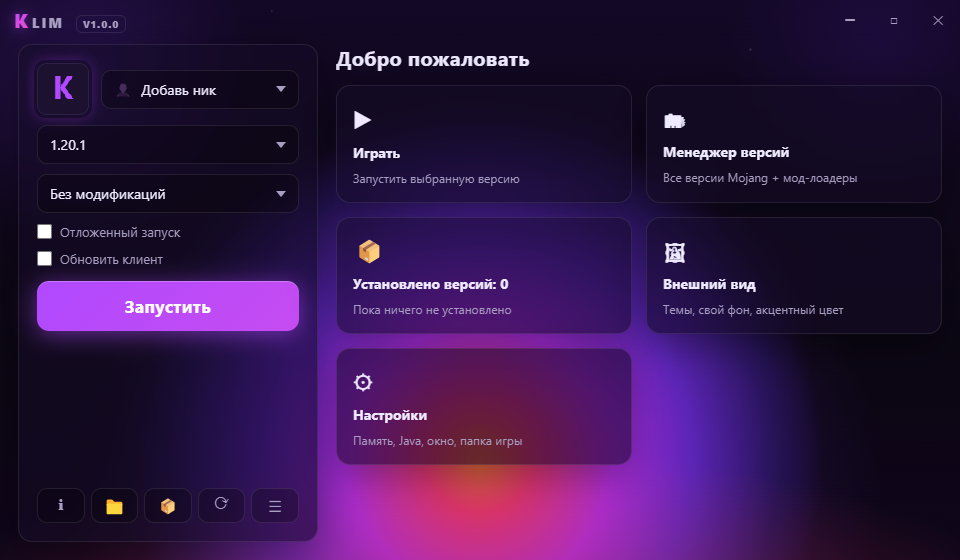
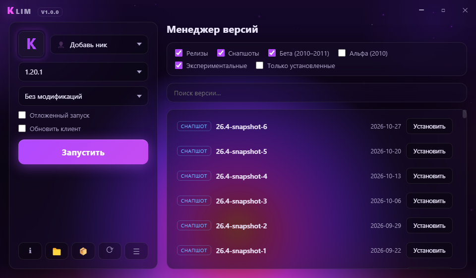
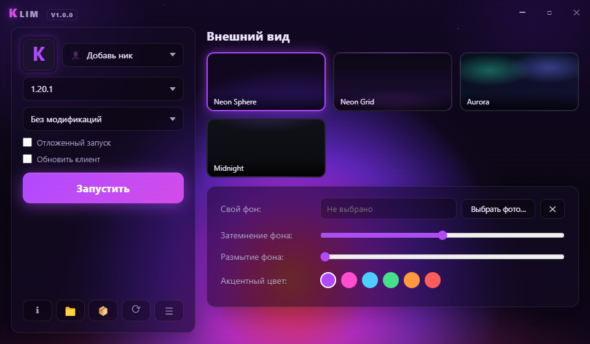
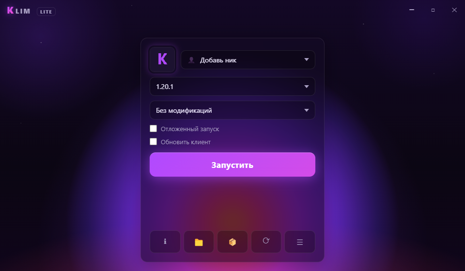

# Klim Launcher

Стильный оффлайн-лаунчер Minecraft в неоновой стилистике. Скачивает и запускает **все официальные версии Mojang** + Fabric и Forge. Оптимизирован под Windows 10 и 11.



## ✨ Возможности

- **Все версии Minecraft** — релизы, снапшоты, беты (2010–2011), альфы и экспериментальные версии напрямую с официальных серверов Mojang
- **Fabric и Forge** в один клик — единый список версий, как у Legacy Launcher
- **Оффлайн-аккаунты** — список ников, UUID как в ванильном оффлайне, скины по нику
- **Java-менеджер** — автопоиск установленных Java + автоматическое скачивание Temurin 8/17/21 под версию игры
- **Настройки** — папка игры, размер окна, память (слайдер 1–16 ГБ + авто), выбор видеокарты, отдельные подпапки по версиям, отложенный запуск, «обновить клиент»
- **Кастомизация** — 4 встроенные темы (фирменная **Neon Sphere**, Neon Grid, Aurora, Midnight), свой фон с затемнением и размытием, акцентные цвета
- **Анимации** — живой фон с частицами и орбами, параллакс, ripple-эффекты, каскадные списки, неоновый прогресс-бар
- **Две сборки** — полная **Klim Launcher** и минималистичная **Klim Lite**

| Менеджер версий | Внешний вид | Klim Lite |
|---|---|---|
|  |  |  |

## 📥 Установка

Скачайте актуальную версию со страницы [Releases](https://github.com/Legoman-1337/Klim-Launcher/releases):

- **Klim Launcher-…-x64.exe** — установщик (полная версия)
- **Klim Launcher-…-portable.exe** — портативная версия без установки
- **Klim Lite-…** — облегчённая сборка без лишнего

**Системные требования:** Windows 10 / 11 (x64). Java скачивается автоматически.

## 🚀 Быстрый старт

1. Добавь ник (кнопка в панели запуска)
2. Выбери версию и модификацию (Fabric / Forge)
3. Нажми «Запустить» — лаунчер сам скачает всё нужное и запустит игру

## 🛠 Сборка из исходников

```bash
npm install
npm start            # запуск в dev-режиме (полная версия)
npm run start:lite   # Lite-версия

npm run build:icon   # генерация иконок (один раз)
npm run build:full   # сборка full → dist/full/
npm run build:lite   # сборка lite → dist/lite/
```

Тест ядра без интерфейса (установка 1.20.1 + Fabric):

```bash
node tools/test-install.js
node tools/test-launch.js
```

## ⚡ Оптимизации

- Анимации фона автоматически ставятся на паузу, когда окно скрыто или свёрнуто
- Частицы рисуются без дорогого shadowBlur, их число зависит от площади окна и числа ядер CPU
- Параллакс и наклоны карточек троттлятся через requestAnimationFrame
- Окно показывается только после готовности рендера — без белой вспышки при запуске
- Правильная AppUserModelId — корректная группировка в таскбаре Windows 10/11
- Докачка файлов после обрыва сети + автопереключение на TLS 1.2, если сеть сбрасывает TLS 1.3

## 📁 Структура

```
src/main/         — главный процесс Electron
  core/           — ядро: манифест версий, установщик, запуск игры, Java, аккаунты
  ipc.js          — IPC-обработчики
  preload.js      — мост в рендерер
src/renderer/     — интерфейс (HTML/CSS/JS)
build/            — иконки
tools/            — генератор иконок, тесты, применение иконки к exe
```

Папки игры: `<игра>/versions`, `libraries`, `assets`, `mods`, `jre` — как у Legacy Launcher.
Конфиг: `%APPDATA%/Klim Launcher/klim-config.json`.

## 📄 Лицензия

MIT — см. [LICENSE](LICENSE).

Minecraft © Mojang Studios. Klim Launcher не связан с Mojang и Microsoft.
